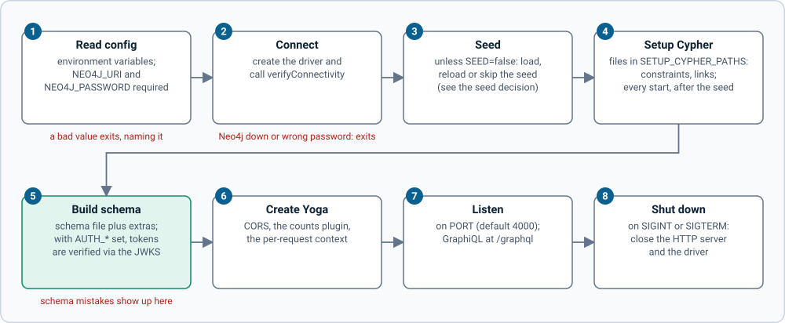
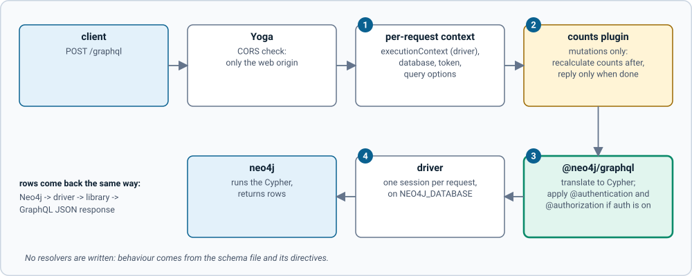

# How grandstack-server works

grandstack-server is a small Node service that exposes a GraphQL API over a Neo4j database. You describe your data in a GraphQL schema file; [`@neo4j/graphql`](https://neo4j.com/docs/graphql/) turns it into a full API (queries, filters, sorting, create/update/delete) and translates every request into Cypher. [GraphQL Yoga](https://the-guild.dev/graphql/yoga-server) serves it over HTTP.

Applies to grandstack-server v0.7.1 (`@neo4j/graphql` 7.6.4, `graphql` 16.14, Node 22 or later).

## What is in the repo

| Path | Purpose |
| --- | --- |
| `src/index.ts` | Entry point: wires everything together (below). |
| `src/config.ts` | Reads and validates environment variables ([configuration](configuration.md)). |
| `src/seed.ts` | Loads the seed Cypher file when needed ([seeding](seeding.md)). |
| `src/counts.ts`, `src/refreshCountsPlugin.ts` | Keeps stored film counts correct after mutations ([mutations](mutations.md#stored-counts-are-refreshed-after-every-mutation)). |
| `schema/schema.graphql` | **The API.** Your types, fields and relationships ([schema guide](schema-guide.md)). |
| `seed/movies.cypher` | Sample data (152 films, 464 people). |
| `tooling/neo4j-directives.graphql` | Stub declarations of Neo4j directives so lint and breaking-change tools can read the schema. |
| `scripts/` | `schema-check.sh` (breaking changes), `generate-schema-docs.mjs`, `check-links.mjs`. |
| `test/` | Unit tests (vitest). |
| `Dockerfile` | Multi-stage build, runs as the non-root `node` user. |

## Startup sequence

`src/index.ts` runs these steps in order. If any step throws, the process exits with the error, so a bad configuration fails fast.

1. **Read configuration** from environment variables. `NEO4J_URI` and `NEO4J_PASSWORD` are required. `MODEL` (default `movies`) picks the schema, setup, seed and plugin defaults ([models](configuration.md#models)); explicit variables win over them.
2. **Create the Neo4j driver** and call `verifyConnectivity`. This fails immediately if Neo4j is unreachable or the credentials are wrong.
3. **Seed** (unless `SEED=false` or the model has no seed): decide whether to load the model's seed, `seed/movies.cypher` for Movies ([rules](seeding.md)).
4. **Run setup Cypher**: the model's `setup.cypher` first, then `SETUP_CYPHER_PATHS`, if set (idempotent constraints, indexes and data fix-ups, run at every start, after the seed so it also applies to freshly loaded data).
5. **Read the schema**: the file at `SCHEMA_PATH` plus any `SCHEMA_EXTRA_PATHS`, joined (with `@mutation(operations: [])` added to every node type when `READ_ONLY=true`), and build the executable schema with `new Neo4jGraphQL({ typeDefs, driver, features }).getSchema()`. If the `AUTH_*` variables are set, `features.authorization` is a remote JWKS with issuer and audience checks. With `FEDERATION=true` it calls `getSubgraphSchema()` instead, which needs a federation `@link` in the schema. Schema errors, for example a missing `@node`, surface here.
6. **Create the Yoga server** with CORS, the counts plugin (if `REFRESH_COUNTS` is not `false`) and the per-request context below.
7. **Listen** on `PORT`. The GraphQL endpoint is `/graphql`; opening it in a browser shows GraphiQL.
8. On `SIGINT` or `SIGTERM` it closes the HTTP server and the driver.

## What happens to a request

*Figure: the eight start-up steps in order. Click the image for full size; the numbered notes below carry the same information as text.*

1. **Read config.** Environment variables; `NEO4J_URI` and `NEO4J_PASSWORD` are required, and a bad value exits with a message that names it.
2. **Connect.** Create the driver and call `verifyConnectivity`; an unreachable Neo4j or a wrong password exits here.
3. **Seed.** Unless `SEED=false`, decide whether to load the seed file (see the seed decision in [seeding](seeding.md)).
4. **Setup Cypher.** Run the files in `SETUP_CYPHER_PATHS` on every start, after the seed (idempotent constraints, indexes and data fix-ups).
5. **Build the schema.** The base schema file plus `SCHEMA_EXTRA_PATHS`; with the `AUTH_*` variables set, tokens are verified against the JWKS. Schema mistakes (for example a missing `@node`) surface here.
6. **Create Yoga.** CORS, the counts plugin (unless `REFRESH_COUNTS=false`) and the per-request context.
7. **Listen.** On `PORT` (default 4000); GraphiQL is at `/graphql`.
8. **Shut down.** On `SIGINT` or `SIGTERM` close the HTTP server and the driver.

*Figure: the path every request takes. Click the image for full size; the numbered notes below carry the same information as text.*

1. **Per-request context.** `executionContext` (the driver), `sessionConfig.database`, `token` (the `Authorization` header) and `cypherQueryOptions`.
2. **Counts plugin.** Wraps execution for mutations only: after the operation runs it recalculates the stored counts, then returns.
3. **The library does the work.** `@neo4j/graphql` translates the operation to Cypher and applies `@authentication` and `@authorization` rules when auth is on.
4. **Driver and database.** One session per request on `NEO4J_DATABASE`; rows come back the same way as a GraphQL JSON response.

Nothing in this repo writes resolvers. Behaviour comes from the schema file and the directives in it.

## The per-request context

Yoga calls `context` for every request in `src/index.ts`. `@neo4j/graphql` reads these keys:

| Key | Value here | What it does |
| --- | --- | --- |
| `executionContext` | the shared driver | The driver (or session or transaction) used to run the generated Cypher. With a driver, the library opens a session for each request. |
| `sessionConfig.database` | `NEO4J_DATABASE` (default `neo4j`) | Database every request runs against. Only used when `executionContext` is a driver. |
| `token` | the `Authorization` header, if any | A bearer token (with or without `Bearer `). Ignored unless the `AUTH_*` variables are set; then it is verified and its claims drive `@authentication` and `@authorization` ([schema guide](schema-guide.md#authentication-and-authorization-rules-in-v7)). |
| `cypherQueryOptions.addVersionPrefix` | `NEO4J_CYPHER_VERSION_PREFIX` (default `false`) | `true` prefixes generated queries with the Cypher version the library targets; `false` lets the database use its default. |

Other keys exist but are not set. `jwt` supplies an already-decoded token payload and takes precedence over `token`. `cypherParams` supplies named parameters that `@cypher` fields can reference as `$name`, for example a tenant id. `transaction` sets metadata and a timeout for the transaction. The rest of `cypherQueryOptions` (`runtime`, `planner`, `replan`, and so on) are query-tuning options left at the database default.

## Limits to know about

- Titles and names act as keys (unique constraints), so there are no ids. See [seeding](seeding.md).
- Community Neo4j supports one database, which is why the default is `neo4j`.
- `graphql` must stay on 16.x, because `@neo4j/graphql` 7.6.4 declares it as a peer dependency (graphql 17 is newer but not supported).
- **Authentication is off by default.** With no `AUTH_*` variables anyone who can reach the endpoint can read and write everything. Turn it on as described in [configuration](configuration.md#authentication-and-extra-schema).

Next: [schema guide](schema-guide.md), [mutations](mutations.md), [recipes](recipes.md).
