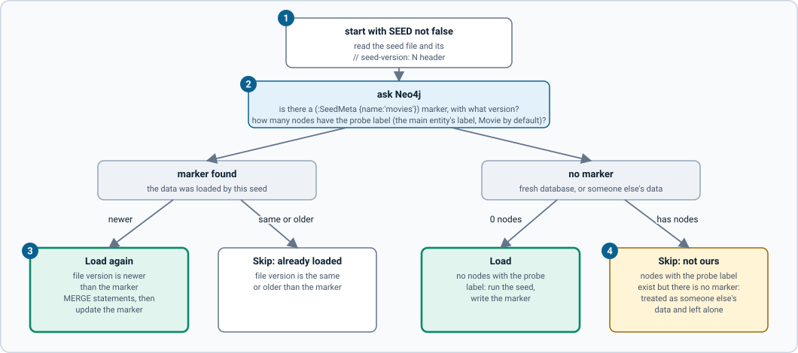

# Seeding

On startup the server can load sample data from a Cypher file. This page describes the file format, when the server loads it, and how to replace it with your own data.

## The seed file

`seed/movies.cypher` (path set by `SEED_PATH`) is a plain Cypher script:

- **Statements end with a semicolon at the end of a line.** The server splits the file on `;` followed by a newline and runs each statement in order. A semicolon inside a line (for example inside a string) does not split.
- Lines starting with `//` are comments. A chunk that is only comments is skipped.
- The first lines should be the constraints, then the data, then any derived values:

```cypher
// seed-version: 3
CREATE CONSTRAINT movie_title IF NOT EXISTS FOR (m:Movie) REQUIRE m.title IS UNIQUE;
UNWIND [ {title:"The Matrix", released:1999, genres:["Sci-Fi"]} ] AS f
MERGE (m:Movie {title: f.title}) SET m.released = f.released
FOREACH (g IN f.genres | MERGE (ge:Genre {name: g}) MERGE (m)-[:IN_GENRE]->(ge));
```

- **Use `MERGE`, not `CREATE`, for data.** Reloading is then safe and idempotent.
- When you write maps in Cypher, keys are bare words (`title:`), not quoted strings.
- The bundled file was **generated** by a one-off script that is not in the repo: it is a batch of `UNWIND` statements (20 films each), a few `SET` statements for taglines and birth years, and the derived-counts statement. Edit it directly; to change a few records add `MATCH ... SET ...;` lines before the last statement.
- Unique constraints (`REQUIRE ... IS UNIQUE`) are what make titles and names usable as keys. They are also why creating a duplicate returns `Constraint validation failed`.

## When the server loads it

The decision is made by `decideSeed` in `src/seed.ts` using three facts: how many nodes with the **probe label** exist (`SEED_PROBE_LABEL`, default `Movie`), the version stored in a marker node `(:SeedMeta {name: 'movies'})`, and the `// seed-version: N` header in the file (1 if absent).

[](diagrams/seed-decision.svg)

*Figure: what the server does with the seed file on start. Click the image for full size; the numbered notes below carry the same information as text.*

1. **Seeding on.** Everything below happens only when `SEED` is not `false`. The seed file's `// seed-version: N` header gives its version (1 if missing).
2. **Two facts from Neo4j.** Is there a `(:SeedMeta {name: 'movies'})` marker and with what version, and how many nodes carry the probe label (`SEED_PROBE_LABEL`, default `Movie`).
3. **Reload by bumping the version.** If the marker exists and the file's version is newer, the seed loads again (it uses `MERGE`, so this is safe) and the marker is updated. Same or older: skip.
4. **Foreign data is protected.** No marker but nodes with the probe label exist: they are someone else's data, so nothing is loaded. An empty database loads and gets a marker.

| Database state | Result |
| --- | --- |
| No marker, no nodes with the probe label | **Load**, then write the marker with the file's version. |
| Marker exists, file version is newer | **Load again** (safe because of `MERGE`), then update the marker. |
| Marker exists, file version is the same or older | Skip ("already loaded"). |
| No marker, but nodes with the probe label exist | **Skip**: it is someone else's data, so it is left alone. |

Consequences:

- **Pointing the server at your own Neo4j** with its own `Movie` data never overwrites it. Set `SEED=false` to be explicit.
- **To ship an updated seed, bump `// seed-version`.** Existing databases reload it on the next start.
- A database seeded before versioning existed (4 movies, no marker) is treated as foreign and is not upgraded. Reset it with `docker compose down -v`.
- Changing the file without bumping the version does nothing on a database that already has the marker.

## Derived counts

`Person.actedCount` and `Person.directedCount` are stored on the nodes so people can be sorted and filtered by film count in plain GraphQL (computed `@cypher` fields cannot be sorted). The last statement of the seed sets them:

```cypher
MATCH (p:Person) SET p.actedCount = COUNT { (p)-[:ACTED_IN]->() }, p.directedCount = COUNT { (p)-[:DIRECTED]->() };
```

After startup the server recalculates them after every mutation, so they stay correct when data is edited through the API ([mutations](mutations.md#stored-counts-are-refreshed-after-every-mutation)). If you change relationships with Cypher directly, run the statement above yourself.

## Using your own data

1. Write your constraints and `MERGE` statements in a Cypher file and set `// seed-version: 1` at the top.
2. Set `SEED_PATH` to the file and `SEED_PROBE_LABEL` to the label of your main entity (for example `Book`), so the foreign-data check looks at the right nodes.
3. If you have no derived counts, set `REFRESH_COUNTS=false` so the plugin does not run the Person count statement.
4. Start with an empty database. The `grandstack` umbrella repo has a worked example of all of this end to end in `docs/build-your-own-app.md`.

## Sample-data caveat

Titles, casts and relationships are real, but ratings and runtimes are approximate and a few casts may be incomplete. Treat the data as illustrative.
